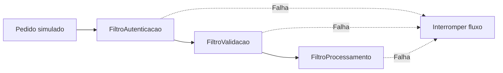

# Tubos e filtros em Java

**Um pedido atravessa etapas independentes de autenticação, validação e processamento.**

Projeto acadêmico que demonstra o padrão arquitetural *Pipes and Filters* com classes e comentários em português. A aplicação cria um pedido simulado, prepara um contexto compartilhado e executa uma sequência de filtros. O objetivo é tornar visíveis a ordem do processamento e a interrupção do fluxo quando uma etapa sinaliza falha.

## Fluxo da demonstração



O construtor de `FluxoDeFiltros` define a ordem das etapas. Cada filtro recebe o mesmo `ContextoFiltro` e implementa o contrato `Filtro`. Quando uma etapa lança `ExcecaoFluxoInterrompido`, a execução sequencial é interrompida e a mensagem é apresentada no terminal.

## Organização

| Arquivo ou pacote | Responsabilidade |
| --- | --- |
| [`Aplicacao.java`](src/main/java/Aplicacao.java) | Ponto de entrada e criação do pedido de demonstração. |
| [`entidades/`](src/main/java/entidades/) | Dados do pedido. |
| [`filtros/`](src/main/java/filtros/) | Contrato, contexto e implementação das etapas. |
| [`fluxos/FluxoDeFiltros.java`](src/main/java/fluxos/FluxoDeFiltros.java) | Composição e execução do pipeline. |
| [`excecoes/`](src/main/java/excecoes/) | Exceção que sinaliza a interrupção. |
| [`utilitarios/`](src/main/java/utilitarios/) | Apoio à simulação de processamento. |

O repositório também contém recursos de um arquétipo Maven em `src/main/resources/archetype-resources`; a demonstração principal está em `src/main/java`.

## Como executar

Use **JDK 11 ou superior** e Maven. O `pom.xml` configura compilação para Java 11.

```bash
git clone https://github.com/dlr-1337/pipes-filters.git
cd pipes-filters
mvn compile
java -cp target/classes Aplicacao
```

A execução utiliza o pedido definido em `Aplicacao.java`, com os valores de demonstração `id_teste`, `comprador_simulado` e `produto_simulado`. Acompanhe as etapas pelo terminal.

## Experimentos para estudo

No código local, altere os dados do pedido para observar o contexto que passa entre as etapas. Para estudar uma interrupção, o filtro de autenticação possui a variável explícita `falhaAutenticacaoSimulada`; compare o comportamento com `false` e `true`.

Para adicionar outra etapa, implemente `Filtro` e registre a instância na ordem desejada em `FluxoDeFiltros`. A sequência é parte do comportamento: uma etapa posterior só é alcançada quando as anteriores terminam sem a exceção de interrupção.

## Escopo e limites

A autenticação é **simulada**, não uma integração real de identidade. O projeto não é um sistema de pedidos pronto para produção, uma API HTTP ou um pipeline distribuído; as etapas são executadas sequencialmente no mesmo processo.

O `pom.xml` declara a API Servlet com escopo `provided`, mas a entrada desta demonstração é a classe Java `Aplicacao`. Os exemplos de teste presentes nos recursos do arquétipo não devem ser confundidos com uma suíte que valide todo o fluxo principal.
